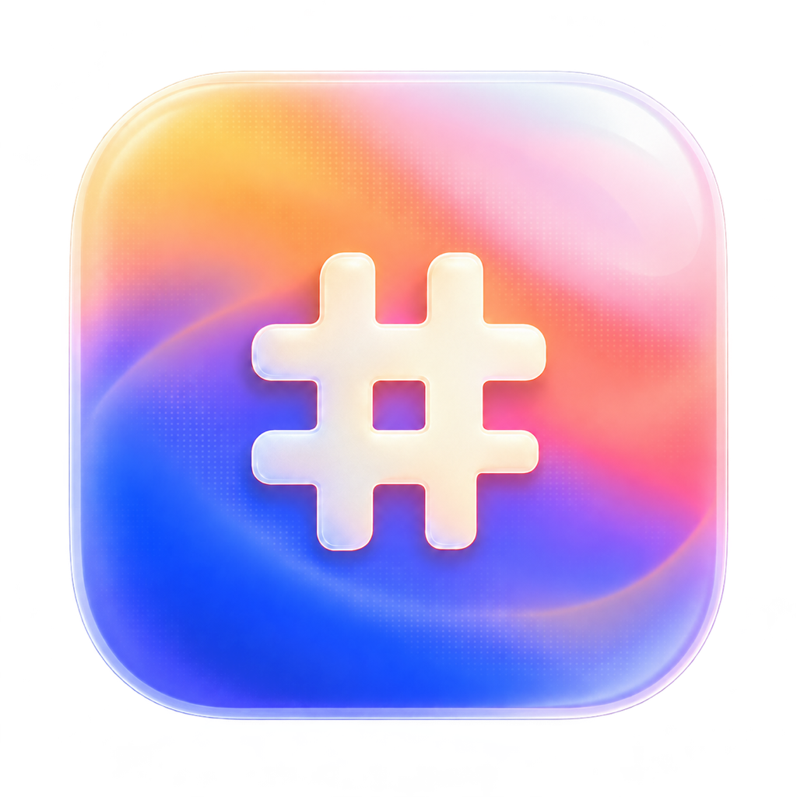
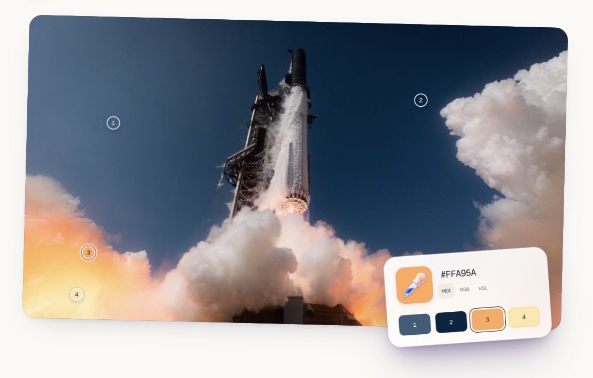
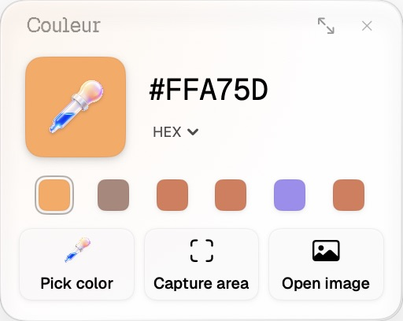
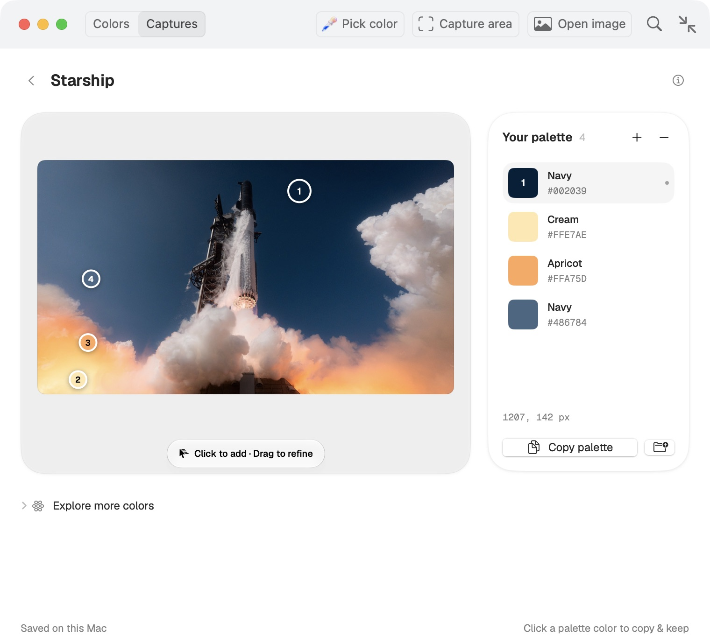

# Couleur

Pick, copy, and keep the colors you find. Free and open source for macOS.

[Explore Couleur](https://aymeric.dev/couleur) · [Releases](https://github.com/Aymericr/couleur/releases)

<a href="https://aymeric.dev/couleur">
  <picture>
    <source media="(prefers-color-scheme: dark)" srcset="docs/images/header-dark.png">
    
  </picture>
</a>

### 1. Pick a color

Press the color well, drag anywhere on your screen, and release. Your color is saved and copied immediately.

Hold **Shift** to keep picking. **Esc** finishes. Click a recent color to copy it again.

### 2. Make it yours

Choose **HEX, RGB, HSL, OKLCH, or Swift code** from the format menu. Expand the picker to name colors, group them, and find where you picked them. Your library stays on your Mac.

### 3. Turn an image into a palette

Choose **Capture area** or **Open image**. Click the image to add a color, then drag its numbered point to refine it. Click a swatch to copy it, or **Copy palette** to take them all.

### Get started

Requires **macOS 14 or later**. The first signed DMG for Apple silicon and Intel is being prepared. You can [build from source](docs/reference.md#build-from-source) in the meantime.

For screen picking, Couleur guides you to **System Settings → Privacy & Security → Screen Recording**. Turn on Couleur, then return to the app. It never records audio.

| Shortcut | Action |
| --- | --- |
| **⌃⌥C** | Pick a color, from any app |
| **⌘⇧A** | Capture an area |
| **⌘O** | Open an image |
| **⌘1 / ⌘2** | Library / compact picker |
| **⌘Z** | Undo a deletion or palette edit |

[Full guide](docs/reference.md) · [Build & release](docs/releasing.md) · [MIT license](LICENSE)

Made by [Aymeric Rabot](https://aymeric.dev). Inspired by the original [Couleurs](https://couleursapp.com/).
