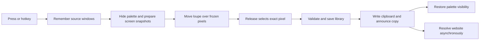

Couleur should borrow Multi’s discipline around focus, input, and measurement first. The largest opportunity is making picking feel like a temporary extension of the app already in use: invoke, select, copy, and carry on typing. The current SwiftUI/AppKit architecture is a good fit for that.

Research date: October 15, 2026. Reviewed 15 relevant Multi/Remotion posts, current Apple documentation, and Couleur at commit `10af6425cca8725d9ac5f81fff3a6128bd3ba207`. Source references below are pinned to that commit. This is a research and implementation proposal; source observations are verified, but focus behavior and performance hypotheses have not been reproduced or benchmarked in this pass.

| Order | Proposed work | Benefit | Scope |
| --- | --- | --- | --- |
| 1 | Specify and verify focus across pick, cancel, expansion, and fullscreen | Return directly to the user’s work | Small investigation; implementation depends on reproduction |
| 2 | Measure gesture → loupe and release → clipboard | Find delays in the primary workflow | Small instrumentation change before optimization |
| 3 | Try direct picking from the menu-bar icon | One-click access while the panel is hidden | Small, isolated interaction experiment |
| 4 | Prototype a capture backend with explicit results and source coordinates | Clearer failures and more dependable provenance | Medium; keep the working selector until parity is proven |
| 5 | Add searchable color descriptors and aliases | Explore the catalog without more navigation | Small to medium; local data and search work |
| 6 | Narrow observation or isolate heavy work only when measurements justify it | Preserve responsiveness as the library grows | Conditional, not a prerequisite |

The relevant articles cover 2021–2024. Their implementation constraints are historical observations, not guarantees about current macOS. Apple APIs and the installed SDK were checked where that distinction affects the recommendation.

**Focus is the first experiment.** Multi’s [activation study](https://multi.app/blog/nailing-the-activation-behavior-of-a-spotlight-raycast-like-command-palette) separates app activation, keyboard focus, launch behavior, and dismissal. It uses a nonactivating panel and treats invocation paths as an explicit behavior contract. Its [sample project](https://github.com/multi-software-co/multi-app-activation-demo) is a useful comparison fixture; the repository itself was not audited here.

Couleur already uses `.nonactivatingPanel` in both presentations. The expanded library deliberately activates the app. However, the loupe creates ordinary borderless panels and explicitly calls `NSApp.activate(ignoringOtherApps: true)`. Its cleanup removes those panels and restores the cursor; the picker’s completion restores the palette’s visibility. There is no stored previous foreground application in that path. These are reasons to test focus restoration, not proof that every pick currently steals focus. See [panel styles and presentation](https://github.com/Aymericr/couleur/blob/10af6425cca8725d9ac5f81fff3a6128bd3ba207/Sources/Couleur/PaletteWindowController.swift#L37), [loupe presentation](https://github.com/Aymericr/couleur/blob/10af6425cca8725d9ac5f81fff3a6128bd3ba207/Sources/Couleur/ScreenLoupe.swift#L161), and [cleanup](https://github.com/Aymericr/couleur/blob/10af6425cca8725d9ac5f81fff3a6128bd3ba207/Sources/Couleur/ScreenLoupe.swift#L220).

The proposed contract distinguishes the persistent compact picker from a transient selection session:

| Situation | Expected result |
| --- | --- |
| Invoke the picker from a browser or editor | Sampling starts without losing the context to return to |
| Release to select | Save and copy once; subsequent typing goes to the original app |
| Hold Shift and select repeatedly | Keep the sampling session; preserve each committed pick |
| Escape or right-click | End the session without a new color or clipboard change |
| Open the expanded library | Activate Couleur intentionally so search and editing work normally |
| Click elsewhere while the compact panel is pinned | Keep the panel visible |
| Switch apps during selection | Cancel cleanly; do not reactivate the old app over the user’s new choice |

Test keyboard invocation, mouse-down dragging, menu-bar invocation, a hidden panel, an already active library, and a permission sheet separately. Start with a text insertion point in another app and verify the next keystroke after completion. Include a fullscreen app, Stage Manager, and two displays with different scale factors.

Apple still documents [nonactivating panels](https://developer.apple.com/documentation/appkit/nswindow/stylemask-swift.struct/nonactivatingpanel). It also provides [`canJoinAllApplications`](https://developer.apple.com/documentation/appkit/nswindow/collectionbehavior-swift.struct/canjoinallapplications), available since macOS 13, for eligible floating windows and overlays across Stage Manager and fullscreen. Couleur targets macOS 14. Test that collection behavior before considering a separate overlay process. It is not a blanket guarantee that every panel configuration will work. Only one of `.primary`, `.auxiliary`, and `.canJoinAllApplications` should be set.

Do not copy Multi’s close-on-resign-key behavior onto Couleur’s pinned palette. Likewise, silent background launch is useful only if we add a background launch mode; an explicit Finder or Dock launch should still reveal the app.

**Measure the complete pick before changing concurrency.** Multi’s [Swift data-stream experiment](https://multi.app/blog/measuring-latency-of-real-time-data-streams-in-swift-delegate-pattern-combine-and-swift-actors) is valuable because it corrects its own unrealistic benchmark. An overloaded queue initially made one approach look disproportionately slow. The useful result is to measure representative workloads and avoid unnecessary scheduling hops, rather than declare actors or Combine universally faster.

Their [end-to-end latency article](https://multi.app/blog/measuring-shared-control-latency) distinguishes transport timing from what someone actually sees, and shows that even the UI chosen for a benchmark can distort the result. For Couleur, a timestamp after updating SwiftUI state is not proof that the feedback has appeared on screen.

For a single pick with Shift released, the current path is:

Three source locations deserve measurement:

- [Screen capture preparation](https://github.com/Aymericr/couleur/blob/10af6425cca8725d9ac5f81fff3a6128bd3ba207/Sources/Couleur/ScreenLoupe.swift#L80) captures displays sequentially. This may affect startup on multiple displays. The loupe then reads a frozen image; it is not streaming a new frame on every pointer movement.
- [The native sampler fallback](https://github.com/Aymericr/couleur/blob/10af6425cca8725d9ac5f81fff3a6128bd3ba207/Sources/Couleur/ScreenPicker.swift#L50) waits 80 ms for non-drag invocation. [Area capture](https://github.com/Aymericr/couleur/blob/10af6425cca8725d9ac5f81fff3a6128bd3ba207/Sources/Couleur/RegionCapture.swift#L93) waits 100 ms before invoking the selector. These waits serve compositor timing; removing them without verifying captured content would be premature.
- [Adding a color](https://github.com/Aymericr/couleur/blob/10af6425cca8725d9ac5f81fff3a6128bd3ba207/Sources/Couleur/ColorStore.swift#L207) saves synchronously before copying. [LibraryFile.save](https://github.com/Aymericr/couleur/blob/10af6425cca8725d9ac5f81fff3a6128bd3ba207/Sources/CouleurCore/Library.swift#L140) encodes the library, reads and validates the old file, writes the backup, and writes the replacement. That preserves honest save feedback but could become significant with a large history. No slowdown was measured here.

Add local [`OSSignposter`](https://developer.apple.com/documentation/os/ossignposter) intervals for input received, capture ready, first loupe draw, release, save complete, clipboard success, and session cleanup. Compare cold and warm picks, 1 versus multiple displays, and preview libraries with 100, 1,000, and 10,000 colors. Keep image capture timing separate from pointer responsiveness. Record distributions such as median and p95, plus cancellation failures; pair timing measurements with rendered-frame inspection.

Keep the direct AppKit mouse-event path. If profiling identifies excessive redraws, coalesce intermediate pointer positions while preserving the exact release position and modifier state. If disk persistence dominates, design an ordered save mechanism with explicit failure handling before moving writes off the main actor. Do not replace durable saves with fire-and-forget tasks. Website lookup already happens after saving and copying, so it should stay outside the immediate interaction path.

**Capture should have a clear result, including its provenance.** Multi uses ScreenCaptureKit in its screen-sharing pipeline, but the posts reviewed do not provide a reusable permission-onboarding implementation. The following proposal comes from Couleur’s existing capture code and Apple’s capture APIs.

Couleur currently has two capture mechanisms: `SCScreenshotManager` for the custom loupe, and `/usr/sbin/screencapture -i -s` for the native area selector. The second is familiar and supports useful system selection gestures. It also requires a temporary file and a separate way to recover the selected rectangle. [CaptureSelection](https://github.com/Aymericr/couleur/blob/10af6425cca8725d9ac5f81fff3a6128bd3ba207/Sources/Couleur/ScreenSource.swift#L58) reads a screenshot extended attribute, falling back to observed mouse endpoints and dimension checks. [RegionCapture](https://github.com/Aymericr/couleur/blob/10af6425cca8725d9ac5f81fff3a6128bd3ba207/Sources/Couleur/RegionCapture.swift#L106) obtains source windows after the screenshot returns.

A small capture boundary could return the image, selected rectangle, capture timestamp, and best-effort source together, with separate outcomes for cancellation, denied access, unavailable content, and other failures. Both mechanisms could feed the existing palette extractor and catalog. First prove that this boundary makes errors and metadata easier to reason about; it does not require a plugin architecture.

Apple’s [ScreenCaptureKit session](https://developer.apple.com/videos/play/wwdc2023/10136/) demonstrates obtaining a filter through the system picker and passing it to the screenshot API. However, [`SCContentSharingPickerMode`](https://developer.apple.com/documentation/screencapturekit/sccontentsharingpickermode) covers windows, apps, and displays, not an arbitrary dragged rectangle. It is a candidate for an optional window-capture workflow, not a drop-in replacement for Capture area.

The installed Apple SDK confirms that [`captureImage(in:)`](https://developer.apple.com/documentation/screencapturekit/scscreenshotmanager/captureimage(in:completionhandler:)) is available from macOS 15.2, and the configurable [`captureScreenshot(contentFilter:configuration:)`](https://developer.apple.com/documentation/screencapturekit/scscreenshotmanager/capturescreenshot(contentfilter:configuration:completionhandler:)) API from macOS 26. These APIs capture specified content; they do not by themselves supply rectangle-selection UI or eliminate permission concerns. A macOS 14 fallback remains necessary under the current deployment target.

Validate permission denied, permission enabled but capture failing, cancellation, display removal, selection moved with Space, and regions spanning multiple windows. A source website must remain optional. Preserve the current browser matching and allowlist checks; never substitute the app that becomes foreground after capture for the app that supplied the pixels. See [BrowserSource](https://github.com/Aymericr/couleur/blob/10af6425cca8725d9ac5f81fff3a6128bd3ba207/Sources/Couleur/BrowserSource.swift#L16).

The current [access guide](https://github.com/Aymericr/couleur/blob/10af6425cca8725d9ac5f81fff3a6128bd3ba207/Sources/Couleur/CaptureAccessView.swift#L9) already distinguishes granted access from capture failure, and [relaunch](https://github.com/Aymericr/couleur/blob/10af6425cca8725d9ac5f81fff3a6128bd3ba207/Sources/Couleur/AppRelaunch.swift#L7) waits for the previous instance before opening the library. Extend those working states rather than building another generic permissions wizard. Diagnose a failing capture through the actual backend result, rather than assuming the Settings switch proves capture will succeed.

**The menu bar can shorten access without becoming another dashboard.** Multi’s [NSStatusItem article](https://multi.app/blog/pushing-the-limits-nsstatusitem) shows how an AppKit status button can host SwiftUI, size itself from content, and support more than one target. Couleur already owns an `NSStatusItem`; it currently opens a conventional menu. See [App.swift](https://github.com/Aymericr/couleur/blob/10af6425cca8725d9ac5f81fff3a6128bd3ba207/Sources/Couleur/App.swift#L192).

Try a normal click on the eyedropper starting a pick immediately, with a secondary click retaining the management menu. Keep the compact window’s visible Pick color, Capture area, and Open image actions. A current-color swatch or code in the menu bar could be optional later, but variable-width content should earn its space on a crowded menu bar. Check keyboard and VoiceOver access, secondary-click behavior, and recovery after cancellation. Do not copy the article’s fixed 24-point height as a timeless system measurement; size against the actual status bar and test current OS appearances.

**The emoji picker offers a useful pattern for the color catalog.** Multi’s [custom emoji picker](https://multi.app/blog/designing-a-custom-inclusive-emoji-picker) separates data, annotations, and categories from the presentation. Its published utilities contain searchable names and keywords, not the picker’s UI. The transferable idea is a local vocabulary supporting exploration.

Couleur already generates names from nearby color anchors, assigns perceptual families, and searches names, provenance, notes, and URLs. See [ColorIntelligence.swift](https://github.com/Aymericr/couleur/blob/10af6425cca8725d9ac5f81fff3a6128bd3ba207/Sources/CouleurCore/ColorIntelligence.swift#L37) and [current search](https://github.com/Aymericr/couleur/blob/10af6425cca8725d9ac5f81fff3a6128bd3ba207/Sources/Couleur/ColorStore.swift#L60). A full query currently has to occur within one searchable field.

Add derived descriptors such as light/dark, muted/vivid, family, and a small editorial alias vocabulary. Match query tokens across fields so “muted blue” and “Slack blue” work naturally. Preserve user-written names; recomputed suggestions should not rename the library. Derive hue and chroma labels from explicit, tested thresholds. Keep contextual roles such as background or accent attached to a capture’s analysis, because an isolated color has no universal role. This gives us more intelligent exploration within the existing search field and grouped views, without adding navigation or requiring a remote model.

**Keep the hybrid architecture and be selective about deeper machinery.** Multi’s [SwiftUI migration account](https://multi.app/blog/moving-to-swiftui-from-macos-cocoa-or-ios-cocoa-touch) supports incremental adoption and calls out AppKit bridges for input and first-responder control. Couleur already follows that pattern: SwiftUI content sits inside AppKit-managed panels and a native library toolbar. There is no case here for a framework rewrite.

Their [Combine article](https://multi.app/blog/is-swift-combine-dead) highlights a concrete trap: `@Published` emits before assignment, so a subscriber rereading the model can see the old value. Couleur’s [toolbar bridge](https://github.com/Aymericr/couleur/blob/10af6425cca8725d9ac5f81fff3a6128bd3ba207/Sources/Couleur/LibraryController.swift#L52) already defers refresh for this reason. It subscribes to the whole store, though, so profiling could justify a narrower set of updates. Apple now supports [Observation on macOS 14](https://developer.apple.com/documentation/swiftui/migrating-from-the-observable-object-protocol-to-the-observable-macro), which can track properties actually read by a view. That is an incremental option, not evidence that the existing Combine code must be replaced.

Multi’s [XPC example](https://multi.app/blog/how-and-when-to-use-xpc-services) solves a specific video SDK’s occlusion behavior and separates overlay rendering into another process. It also discusses crash isolation and limitations of interactive UI in that service setup. Couleur has no equivalent video SDK constraint. Its palette extraction already runs in a detached task. Introduce XPC only if an identified dependency needs fault isolation or a proven process-level constraint requires it; async work alone is not a reason.

Their [remote-control engine](https://multi.app/blog/building-a-macos-remote-control-engine) synthesizes Core Graphics events and prioritizes cancellation when local input takes over. Couleur needs the cancellation discipline, not synthetic clicks or keyboard events. Preserve its current local event handling, Shift state at release, cursor cleanup, and global hotkey. Do not broaden permissions just to imitate a remote-control architecture.

**Color fidelity and restrained motion remain product requirements.** Multi’s [WebRTC quality work](https://multi.app/blog/making-illegible-slow-webrtc-screenshare-legible-and-fast) illustrates how compression, buffering, and subsampling can undermine a visually sensitive workflow. Couleur’s equivalent requirement is that displayed, stored, and copied colors agree under a defined color-space conversion. Its [PaletteImage](https://github.com/Aymericr/couleur/blob/10af6425cca8725d9ac5f81fff3a6128bd3ba207/Sources/CouleurCore/PaletteImage.swift#L37) already separates bounded analysis from exact pixel reads and converts samples to sRGB. Any future HDR or Display P3 support needs explicit storage and export semantics; an HDR screenshot API is not sufficient on its own. Multi’s hidden watermark technique should not be applied to stored captures or sampled pixels.

Couleur already has gated macOS 26 glass, continuous corners, shadow borders, and accessibility fallbacks in [Design.swift](https://github.com/Aymericr/couleur/blob/10af6425cca8725d9ac5f81fff3a6128bd3ba207/Sources/Couleur/Design.swift#L5). Apple also offers an AppKit [`NSGlassEffectView`](https://developer.apple.com/documentation/appkit/nsglasseffectview) on macOS 26. Use such materials for controls while keeping swatch interiors unfiltered. The Multi archive predates Liquid Glass and does not supply a current shadow or glass recipe.

The [window morph](https://github.com/Aymericr/couleur/blob/10af6425cca8725d9ac5f81fff3a6128bd3ba207/Sources/Couleur/PaletteWindowController.swift#L176) already preserves one panel and avoids stretching its text. Its 250 ms resize plus 100 ms arrival currently finishes before queued actions run. Evaluate fast reversal and picking during a transition as part of responsiveness work. The goal is to preserve continuity while promptly honoring the latest intent, with Reduce Motion respected. That recommendation follows Couleur’s existing craft requirements; it is not a motion implementation published by Multi.

The complete reading map records which parts are actionable and which are mostly background:

| Post | Published | Relevance to Couleur |
| --- | --- | --- |
| [Nailing the Activation Behavior of a Spotlight / Raycast-Like Command Palette](https://multi.app/blog/nailing-the-activation-behavior-of-a-spotlight-raycast-like-command-palette) | 2024-02-14 | Highest priority: focus contract and invocation cases. Adapt dismissal to a persistent utility. |
| [Pushing the limits of NSStatusItem beyond what Apple wants you to do](https://multi.app/blog/pushing-the-limits-nsstatusitem) | 2023-05-30 | Direct menu-bar interaction; avoid a crowded replacement toolbar. |
| [Measuring latency of real time data streams in Swift](https://multi.app/blog/measuring-latency-of-real-time-data-streams-in-swift-delegate-pattern-combine-and-swift-actors) | 2023-06-21 | Representative measurements before concurrency changes. |
| [Measuring Shared Control Latency](https://multi.app/blog/measuring-shared-control-latency) | 2024-03-05 | Measure visible outcomes and compare equivalent workloads. |
| [Making Illegible, Slow WebRTC Screenshare Legible and Fast](https://multi.app/blog/making-illegible-slow-webrtc-screenshare-legible-and-fast) | 2024-03-05 | Fidelity-first thinking; codec tuning is outside Couleur’s scope. |
| [Building a macOS remote control engine](https://multi.app/blog/building-a-macos-remote-control-engine) | 2023-03-29 | Input cancellation and modifier care; remote event injection is unnecessary. |
| [How and when to use XPC services](https://multi.app/blog/how-and-when-to-use-xpc-services) | 2023-03-15 | A future isolation tool, not a default overlay requirement. |
| [Moving to SwiftUI from macOS Cocoa or iOS Cocoa Touch](https://multi.app/blog/moving-to-swiftui-from-macos-cocoa-or-ios-cocoa-touch) | 2023-04-05 | Supports our existing hybrid approach and stable view identity. |
| [Is Swift Combine Dead?](https://multi.app/blog/is-swift-combine-dead) | 2022-10-11 | Useful publication-order warning; account for modern Observation. |
| [Designing a custom, inclusive emoji picker](https://multi.app/blog/designing-a-custom-inclusive-emoji-picker) | 2022-03-18 | Data-driven aliases and categories for richer local search. |
| [Preparing for SwiftUI with NSStackViews](https://multi.app/blog/preparing-for-swiftui-in-appkit-code-by-using-nsstackviews-instead-of-nib-files) | 2022-08-24 | Programmatic composition; limited incremental benefit in this codebase. |
| [Why Remotion is a native macOS app](https://multi.app/blog/why-remotion-is-a-native-macos-app-not-electron) | 2021-09-27 | Native conventions and an unobtrusive, always-available utility. Historical resource comparisons are not current benchmarks. |
| [Improving code reviews with Xcode Cloud](https://multi.app/blog/improving-code-reviews-with-xcode-cloud) | 2023-04-28 | Validate release builds, not only debug. Couleur’s [existing workflow](https://github.com/Aymericr/couleur/blob/10af6425cca8725d9ac5f81fff3a6128bd3ba207/.github/workflows/check.yml#L8) already tests and packages a release build; no CI migration is needed. |
| [Refactoring Legacy Systems](https://multi.app/blog/refactoring-legacy-systems) | 2023-03-01 | Compare a capture alternative behind a small boundary, with a retained fallback. |
| [Move fast to unbreak things](https://multi.app/blog/move-fast-to-unbreak-things) | 2022-08-10 | Small releases and fast feedback; preserve meaningful correctness tests. |

A sensible first implementation is a focus verification pass plus local timing instrumentation. Then address whichever behavior or delay that evidence identifies. Menu-bar access and richer search are independent small improvements; a replacement area-capture backend should follow a prototype that proves selection, cancellation, color fidelity, and provenance parity. The research itself added no application changes. The subsequent build 9 implementation, measurements, and remaining validation limits are recorded in [Picker focus and responsiveness](picker-responsiveness.md).
